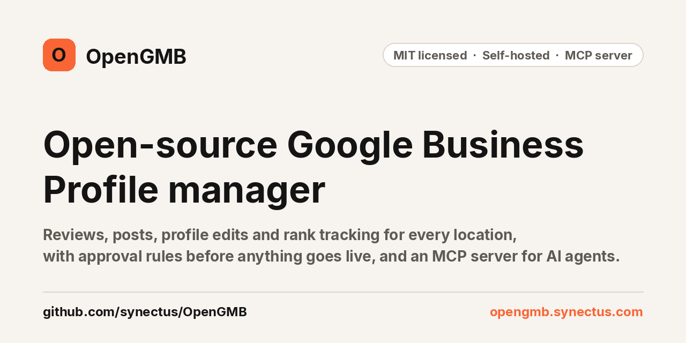
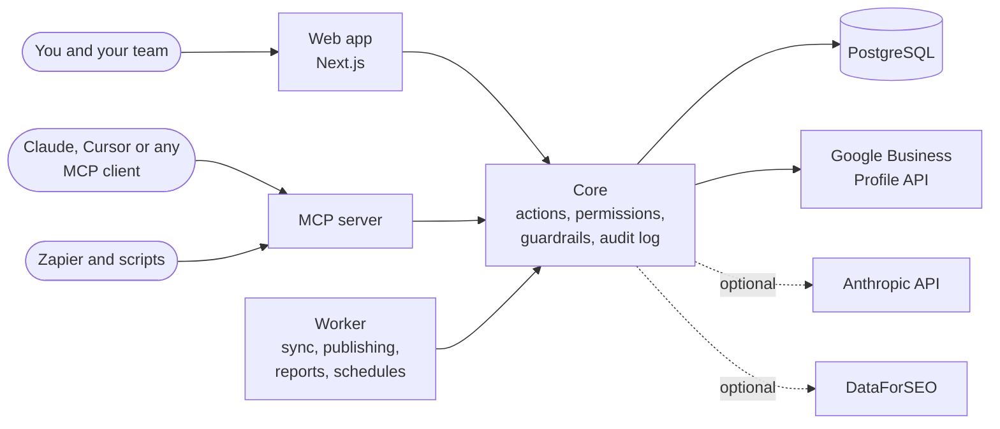

<p align="center">
  <a href="https://opengmb.synectus.com/open-source">
    
  </a>
</p>

<p align="center">
  <a href="LICENSE"></a>
  <a href="https://github.com/synectus/OpenGMB/actions/workflows/ci.yml"></a>
  <a href="https://github.com/synectus/OpenGMB/stargazers"></a>
  <a href="https://opengmb.synectus.com/docs/mcp"></a>
  <a href="SETUP.md"></a>
  
  
</p>

<p align="center">
  <a href="https://opengmb.synectus.com"><b>Website</b></a> ·
  <a href="https://opengmb.synectus.com/docs"><b>Docs</b></a> ·
  <a href="SETUP.md"><b>Self-host guide</b></a> ·
  <a href="https://opengmb.synectus.com/docs/mcp/tools"><b>MCP tools</b></a> ·
  <a href="https://opengmb.synectus.com/roadmap"><b>Roadmap</b></a> ·
  <a href="https://opengmb.synectus.com/pricing"><b>Hosted version</b></a>
</p>

# ApexGMB 🚀

> **Next-Gen Autonomous Google Business Profile & Local Rank Engine**  
> Complete with Web Dashboard, Browser Extension, MCP Server, and Agent Skills Suite.

ApexGMB manages Google Business Profiles for local businesses and the agencies that run them. Reviews, review replies, posts, profile edits, performance, reports, and Maps rank tracking—for every location, in one place.

### ✨ Key Capabilities

1. 🏢 **Centralized Profile & Review Engine (`apps/web`)**
   * Review management with human-in-the-loop approval gates.
   * Multi-location post scheduling and Google Maps rank tracking.
   * Docker-ready self-hosted deployment.

2. 🧩 **MapRank Everywhere Chrome Extension (`apps/extension`)**
   * Live Google Maps audits, primary/secondary category inspector, and local SEO optimizations directly in your browser.
   * Teleport location coordinates for geo-grid visibility testing.

3. 🧠 **Autonomous Agent Skills Suite (`skills/`)**
   * `ghulam-ali-local-seo-mastery`: Ghulam Ali's 5-Hour Local SEO Masterclass covering NAP consistency audits, geo-grid proximity expansion, neighborhood geo-silos, local citation matrix, and master `LocalBusiness` JSON-LD schema.
   * `ecommerce-seo-architecture`: Ghulam Ali eCommerce 3-click silo architecture, faceted navigation defense, and Product/Offer rich snippets schema.
   * `ahrefs-competitive-intelligence`: Complete 6-in-1 Free Ahrefs SaaS alternative (Site Explorer, Keywords Explorer, Site Audit, Content Explorer, Rank Tracker, and AI & Brand Tracking GEO/AEO Radar).
   * `pbn-aged-domain-authority`: Aged domain evaluation, Harmonic Centrality, Common Crawl AI training ingestion, and parasite SEO market probing.
   * `gmb-orm-brand-defense`: Online Reputation Management (ORM) & Branded SERP 10-asset blanket defense.
   * `gmb-profile-audit`: Comprehensive SEO and health audit.
   * `gmb-review-automation`: Sentiment-driven, contextual review response generator.
   * `gmb-weekly-post-engine`: Geo-targeted, keyword-dense weekly post creator.
   * `gmb-competitor-benchmark`: Local Map Pack gap and competitor ranking analysis.
   * `gmb-agency-client-pitch`: Automated ROI and client proposal generator.

4. 🔌 **Model Context Protocol (MCP) Server (`apps/mcp`)**
   * Directly interfaces with Claude, Cursor, Antigravity, and AI agents to automate GMB actions while keeping human approval controls.

5. ⚡ **Multi-LLM Native Support**
   * Integrated support for **Google Gemini 2.5 Flash / Pro**, **OpenAI GPT-4o / GPT-4o-mini**, and **Anthropic Claude**.

---

## 🛡️ Online Reputation Management (ORM) & SEO Defense

> **SEO is the engine inside ORM.**  
> While traditional SEO targets discovery searches (*"wedding photographer"*), ORM controls **branded searches** (*"[Brand] reviews"*, *"[Brand] complaints"*, *"[Brand] scam"*).

ApexGMB treats your search results as an impenetrable fortress:
* **The 10-Asset SERP Blanket**: Pushes negative or defamatory links down to Page 2 (where less than 1% of users click) by ranking 10 high-authority owned properties (Website, GBP, LinkedIn, YouTube, Crunchbase, Trustpilot, Substack, Medium).
* **Automated Review Gating (GoHighLevel Architecture)**: Automatically sends SMS/email review triggers 1 hour post-service. Happy customers (4–5 stars) are routed directly to Google Maps; dissatisfied customers (1–3 stars) are intercepted to a private manager feedback form.
* **Entity & AI Overview Protection**: Uses JSON-LD schema `sameAs` entity clustering to anchor brand legitimacy in Google's Knowledge Graph and prevent AI hallucinations or negative summaries in Google SGE / AI Overviews.
* **Crisis De-escalation (A.A.A. Protocol)**: Pre-built response blueprints for de-escalating customer complaints publicly without admitting legal liability while moving discussions offline.

Run the ORM engine via CLI:
```bash
python3 skills/scripts/gmb_ai_runner.py orm --business "Apex Media Studio" --category "Photography Studio" --city "Delhi NCR"
```

---

## 🌐 Aged Domain Authority, Harmonic Centrality & Parasite SEO

> Based on the 2026 search architectures by **Kalin Karakehayov** (200k+ domains), **Charles Floate**, and **David Quaid**:

* **Zero-Traffic Link Math**: Contextual backlinks from clean aged domains with strong historical authority and referring domain diversity pass massive ranking power to Google Business Profiles and money sites—even if the aged domain gets 0 organic traffic.
* **Harmonic Centrality & Common Crawl Ingestion**: Moving beyond simple PageRank to proximity in the global web graph. Domains with high Harmonic Centrality are prioritized by Common Crawl dumps, forcing brand entities into the foundational training corpora of LLMs (Gemini, ChatGPT, Claude, Perplexity).
* **Parasite SEO Probing**: Rapidly test keyword commercial conversion in 48–72 hours using high-DA parasite assets (LinkedIn Pulse, Medium, Substack, Reddit) before investing in custom domains.
* **PBN Footprint Neutralization**: Class-C subnet IP separation, registrar rotation, non-reciprocal link flow, and natural outbound reference profiles.

Run via CLI:
```bash
# Evaluate an Aged Domain for Authority & Harmonic Centrality
python3 skills/scripts/gmb_ai_runner.py domain-eval --domain "oldphotostudio.com" --niche "Photography Studio"

# Plan a Parasite SEO Probing Campaign
python3 skills/scripts/gmb_ai_runner.py parasite-probe --business "Apex Media Studio" --keyword "luxury wedding photographer Delhi" --niche "Wedding Photography"
```

---

## 📊 Free Ahrefs Suite: 6-in-1 SEO & AI Platform

> A 100% free open-source alternative to Ahrefs' \$199–\$999/month SaaS subscription, fully replicating all 6 core product engines:

### The 6 Core Free Ahrefs Platforms:
1. **🌐 Site Explorer (`site-explorer`)**: Deeply analyzes domain backlink profiles, referring domain velocity, organic search traffic, ranking keywords, and authority scores (DR & UR 0–100).
2. **🔍 Keywords Explorer (`keywords-explorer`)**: Conducts search intent classification, keyword difficulty (KD 0–100), search volume estimation, and SERP real estate targeting (Map Pack, AI Overviews, Snippets).
3. **🏥 Site Audit (`site-audit`)**: Automated technical crawler checking status codes (404, 301, 500), canonical hygiene, robots.txt, XML sitemaps, single H1 hierarchy, and mobile Core Web Vitals (LCP/CLS/INP).
4. **📰 Content Explorer (`content-explorer`)**: Discovers viral topics, highest-shared guides, backlink velocity, and unlinked brand mentions with automated reclamation pitches.
5. **📈 Rank Tracker (`rank-tracker`)**: Monitors desktop & mobile search engine rankings, Share of Voice (SOV %), SERP features won, and identifies striking-distance quick wins.
6. **🤖 AI & Brand Tracking (`ai-brand-tracker`)**: Tracks brand visibility, sentiment, and citation share across modern AI Search engines (Perplexity, Google AI Overviews, ChatGPT Search, Gemini, Claude).

### Specialized Competitive Sub-Engines:
* **🎯 Content Gap Analysis (`content-gap`)**: Reveals commercial keywords where 2+ competitors rank on Page 1, but your site is missing.
* **🔗 Link Intersect (`link-intersect`)**: Pinpoints high-DA local directories and vendor portals linking to multiple competitors.
* **🏆 Top Pages Teardown (`top-pages-teardown`)**: Reverse-engineers the 5–10 pages driving 80% of competitor search inquiries.
* **⚡ Broken Link Steal (`broken-link-builder`)**: Reclaims backlinks pointing to competitor 404 pages.
* **🛡️ Toxic Link & Disavow (`toxic-link-audit`)**: Detects negative SEO attacks and outputs Google Search Console `disavow.txt` rules.

Run via CLI:
```bash
# 1. Site Explorer (Backlinks, RDs, Traffic & DR/UR)
python3 skills/scripts/gmb_ai_runner.py site-explorer \
  --domain "bhardwajstudio.in" \
  --competitors "weddingwire.in, shaadisaga.com" \
  --niche "Wedding Photography"

# 2. Keywords Explorer (Search Volume, KD & Intent)
python3 skills/scripts/gmb_ai_runner.py keywords-explorer \
  --keyword "wedding photographer Delhi" \
  --niche "Photography Studio"

# 3. Site Audit (Crawl, 404s & Core Web Vitals)
python3 skills/scripts/gmb_ai_runner.py site-audit \
  --url "https://bhardwajstudio.in" \
  --niche "Local Studio"

# 4. Content Explorer (Viral Topics & Mentions)
python3 skills/scripts/gmb_ai_runner.py content-explorer \
  --topic "pre wedding shoot poses and locations" \
  --niche "Wedding Photography"

# 5. Rank Tracker (Track Desktop/Mobile Ranks & SOV)
python3 skills/scripts/gmb_ai_runner.py rank-tracker \
  --domain "bhardwajstudio.in" \
  --keywords "wedding photographer Delhi, candid wedding shoot Noida, pre wedding studio" \
  --location "Delhi NCR"

# 6. AI & Brand Tracking (GEO/AEO Radar in Perplexity & SGE)
python3 skills/scripts/gmb_ai_runner.py ai-brand-tracker \
  --brand "Apex Media Studio" \
  --domain "bhardwajstudio.in" \
  --competitors "Studio Memory, WeddingFilmCo" \
  --niche "Wedding Photography"

# 7. Content Gap Analysis
python3 skills/scripts/gmb_ai_runner.py content-gap \
  --my-site "bhardwajstudio.in" \
  --competitors "weddingwire.in, shaadisaga.com" \
  --niche "Wedding Photography" \
  --city "Delhi NCR"
```

---

## 🛍️ eCommerce & Service Package SEO Architecture

> Based on the comprehensive principles from **Ghulam Ali's eCommerce SEO Course**:

* **3-Click Category Hierarchy**: Eliminates buried URLs and ensures every product or service retainer package is reachable within 3 clicks of the homepage.
* **Faceted Navigation & Parameter Defense**: Prevents duplicate content and index bloat by enforcing self-referencing canonicals on clean category pages and parameter normalization on filter URLs (`?sort=`, `?price=`).
* **Rich Snippets & Google Gold Stars**: Automatically generates Schema.org `Product`, `Offer`, and `AggregateRating` JSON-LD to display review ratings, pricing, and availability directly in Google SERPs for a 25–40% CTR boost.
* **Category Page Copywriting Formula**: Structures pages with an 80–120 word search-intent hook above the product grid, and an authoritative 600+ word buying guide + FAQ with `FAQPage` schema below the grid.

Run via CLI:
```bash
# 1. Design 3-Click Silo & Parameter Defense Architecture
python3 skills/scripts/gmb_ai_runner.py ecom-architecture --store "Apex Studio Store" --categories "Pre-Wedding Shoots, Wedding Films, Portrait Packages"

# 2. Generate Product & Offer Schema (JSON-LD)
python3 skills/scripts/gmb_ai_runner.py product-schema --name "Luxury Wedding Package" --price "75000" --currency "INR" --rating "4.9" --reviews "85"

# 3. Generate Category Page Copy (Above & Below the Grid)
python3 skills/scripts/gmb_ai_runner.py category-content --category "Pre-Wedding Packages" --niche "Wedding Photography" --city "Delhi NCR"
```

---

## 📍 Complete 5-Hour Local SEO Masterclass (Ghulam Ali Zero-to-Hero)

> Encapsulates the end-to-end framework from **Ghulam Ali's 5-Hour Local SEO Masterclass** (`https://youtu.be/5S1c3YXNlJA`):

* **NAP Consistency & Data Aggregator Engineering**: Audits and standardizes the exact canonical Name, Address, and Phone formatting across website headers/footers, GBP, and data aggregators to eliminate algorithmic ranking drag caused by abbreviation discrepancies (e.g. "Road" vs "Rd", suite variations).
* **Geo-Grid Proximity Expansion & Geo-Silos**: Breaks businesses out of the 1–2 mile proximity bubble using hyper-local neighborhood landing pages (`/locations/[neighborhood-service]`), localized Google Map embeds with CID / Place ID binding, driving directions from key landmarks, and localized customer proof.
* **High-Impact Citation Building Matrix**: Generates a tailored submission matrix covering Tier-1 foundational citations (DA 80+), regional registries, and industry-specific vertical directories with exact unbranded anchors and category mappings.
* **Master `LocalBusiness` JSON-LD Schema**: Generates complete, Google Rich Results-compliant structured data with `GeoCoordinates`, `areaServed` multi-locality boundaries, `openingHoursSpecification`, and authoritative `sameAs` entity link clustering.
* **GBP Verification & Re-instatement Protocol**: Video verification checklist (exterior signage, tools of trade, physical door unlock, lease/utility proof) and appeal templates to prevent or reverse sudden listing suspensions.

Run via CLI:
```bash
# 1. Run NAP & Local Citation Consistency Audit
python3 skills/scripts/gmb_ai_runner.py nap-audit \
  --business "Apex Media Studio" \
  --address "Shop 12, Main Market, Sector 15" \
  --phone "+91-9876543210" \
  --website "https://bhardwajstudio.in" \
  --city "Delhi NCR"

# 2. Design Geo-Silo & Neighborhood Landing Page Blueprint
python3 skills/scripts/gmb_ai_runner.py geo-silo \
  --business "Apex Media Studio" \
  --service "Wedding Photography" \
  --neighborhood "Connaught Place" \
  --city "Delhi" \
  --landmarks "CP Metro Gate 4, Janpath, Shivaji Stadium"

# 3. Generate High-Impact Local Citation Directory Matrix
python3 skills/scripts/gmb_ai_runner.py local-citation-matrix \
  --business "Apex Media Studio" \
  --category "Photography Studio" \
  --city "Delhi NCR" \
  --country "India"

# 4. Generate Master Schema.org LocalBusiness JSON-LD
python3 skills/scripts/gmb_ai_runner.py local-schema \
  --business "Apex Media Studio" \
  --category "PhotographyStudio" \
  --address "Shop 12, Main Market, Sector 15" \
  --city "Noida" \
  --state "UP" \
  --zip "201301" \
  --country "IN" \
  --phone "+91-9876543210" \
  --website "https://bhardwajstudio.in" \
  --lat "28.5800" \
  --lng "77.3178"
```

---

## 🔑 Configuring Your API Keys

ApexGMB allows you to supply your own API keys cleanly across all surfaces without hardcoding secrets:

### 1. Browser Extension (MapRank Everywhere)
* Click the extension icon in Chrome.
* Navigate to the **⚙️ Settings** tab.
* Enter your **OpenRouter API Key** (`sk-or-v1-...`) and click **Save Settings**.
* Your key is stored securely in your browser's private `chrome.storage.sync` and never exposed or synced publicly.

### 2. Autonomous Skills & Scripts Runner
Export your API key in your terminal session or add it to your shell profile:
```bash
export OPENROUTER_API_KEY="sk-or-v1-your-key-here"
python3 skills/scripts/gmb_ai_runner.py --skill gmb-profile-audit --name "Your Business"
```

### 3. Web Dashboard & Docker Services
Copy the example environment file and add your keys:
```bash
cp .env.example .env
```
Inside `.env`, populate your preferred provider keys:
```env
OPENROUTER_API_KEY="sk-or-v1-your-key-here"
# Optional direct provider keys:
GEMINI_API_KEY="your-gemini-key"
OPENAI_API_KEY="your-openai-key"
ANTHROPIC_API_KEY="your-anthropic-key"
```
*(Note: `.env` is automatically ignored by `.gitignore` so your keys will never be committed to Git).*

---

<p align="center">
  
</p>

## Why we built it

We run an SEO agency and manage Google Business Profiles for clinics and local businesses. The tools we paid for charged per location, so the bill grew with every client before any work got done. And when we tried AI for replies and posts, we wanted it to draft the routine work while a person still signed off on everything that went live.

So we built the tool we wanted, used it for our own work, and opened the core.

## What it does

<table>
  <tr>
    <td width="50%" valign="top">
      
      <b>Posts</b><br />
      Write, schedule and approve posts for one location or many. A calendar shows what is scheduled, published or made directly on Google.
    </td>
    <td width="50%" valign="top">
      
      <b>Reviews</b><br />
      One inbox for every location's Google reviews. Assign them, add internal notes, and draft replies yourself, with templates or with AI.
    </td>
  </tr>
  <tr>
    <td width="50%" valign="top">
      
      <b>Profile health and edits</b><br />
      A health score with the checks behind it. Edit hours, categories and services across many locations in one change, and catch edits made outside OpenGMB.
    </td>
    <td width="50%" valign="top">
      
      <b>Performance and reports</b><br />
      Calls, website clicks, direction requests and impressions per location, search keywords by month, and reports you can share with a client.
    </td>
  </tr>
</table>

Also in the community edition:

- **Rank tracking** on a geo-grid around each location, next to its competitors, with your own DataForSEO account.
- **AI drafts** for replies, posts and descriptions with your own Anthropic key. No credits, no markup.
- **Review requests** with tracked links, QR codes and public location pages, and no review gating.
- **Approvals inbox**, location groups, white-label branding on reports.
- **REST API (v1)**, outgoing webhooks, and the source of the Zapier app.
- **Two-factor sign-in** (required) and an append-only, hash-chained audit log.

## Built for AI agents

The MCP server exposes around 250 tools, one for every action in the app: list reviews, draft and submit replies, schedule posts, edit hours, pull performance, run a health check, and more. Writes go through the same guardrails and approvals as the web app.

Create a token in **Settings → API tokens** (read only, or read and write), then add the server to your client. For Claude Code:

```sh
claude mcp add --transport http opengmb https://your-mcp-host/mcp \
  --header "Authorization: Bearer sgmb_your_token"
```

Then ask in plain words:

> Draft replies for this week's 1- and 2-star reviews at every location, and put them in the approval queue.

> Which locations lost the most calls last month compared with the month before?

> Schedule a holiday hours post for all dental clients for Friday, and send it for approval.

A human-in-the-loop token can draft and submit, but it cannot approve or publish. Every tool, with its inputs and the permission it needs, is listed at [opengmb.synectus.com/docs/mcp/tools](https://opengmb.synectus.com/docs/mcp/tools).

## Nothing goes live without a person

| What | Rule |
| --- | --- |
| Posts and profile edits | Always need a person's approval |
| Replies to 1 to 3 star reviews | Always need a person, never published automatically |
| Replies to 4 and 5 star reviews | Need a person, unless the owner turns on auto-approve for that client |
| Every reply, post and edit | Checked by guardrail rules first: links, emails, phone numbers, offers, bad hours, banned words. Blocks cannot be overridden; warnings must be acknowledged |
| Healthcare and law firm clients | Extra rule packs (HIPAA-style checks for names, clinical terms and dates; legal ethics) |

The rules run again just before anything is sent to Google.

## Quick start

You need Docker Engine 24 or newer with the Compose plugin, about 4 GB of free RAM while the images build, and a public HTTPS hostname if you want Google sign-in.

```sh
git clone https://github.com/synectus/OpenGMB.git
cd OpenGMB/deploy/selfhost
cp .env.example .env     # set OWNER_EMAIL and OWNER_PASSWORD; the comments explain every value
docker compose up -d --build
```

Open <http://localhost:8080> and sign in with the owner email and password. Two-factor sign-in is required, so have an authenticator app ready and keep the backup codes it shows.

The Google client starts in **mock mode**: under **Settings → Google**, press "Use the sample Google account" to import sample locations and click through everything without any Google keys. Going live needs Google's approval of Business Profile API access for your own Google Cloud project, which you request yourself and which can take a few days.

[SETUP.md](SETUP.md) covers every step: ports, email, Google, backups and upgrades. The same guide is online at [opengmb.synectus.com/docs/self-hosting](https://opengmb.synectus.com/docs/self-hosting).

## How it fits together



Every surface (web, MCP, REST, worker) runs the same actions through one executor, so permissions, guardrails and the audit log apply the same way no matter who or what makes the change.

| Path | What |
| --- | --- |
| `apps/web` | The Next.js app |
| `apps/mcp` | The MCP server (Streamable HTTP) and REST API |
| `apps/worker` | Background jobs: review sync, publishing, reports, schedules, Pub/Sub push |
| `packages/core` | Auth, tenancy, the action registry, the Google client, guardrail rules, the audit log |
| `packages/db` | Drizzle schema and migrations |
| `deploy/selfhost` | The self-host stack (Docker Compose). Use this to run OpenGMB |
| `integrations/zapier` | The Zapier app source |

The `docker-compose.yml` at the repository root is only a development Postgres for contributors.

## Community edition or hosted

| | Community edition (this repo) | [Hosted OpenGMB](https://opengmb.synectus.com) |
| --- | --- | --- |
| Price | Free, MIT | $10 a month per account, as usage credit |
| Who runs it | You, on your server | We do |
| Google Cloud project and API approval | Yours | Ours |
| Clients and locations | Unlimited | Unlimited |
| Reviews, posts, edits, reports, rank tracking | Yes | Yes |
| MCP server, REST API, webhooks | Yes | Yes |
| AI | Your Anthropic key | Included, paid from credit |
| Teams and roles | One owner login | Yes |
| Client portal with your branding | No | Yes |
| Custom domains | No | Yes |

If you would rather not run servers or wait for Google's API approval, the hosted version gives you $0.50 of trial credit with no card.

## Roadmap

What we are working on and what comes next is public at [opengmb.synectus.com/roadmap](https://opengmb.synectus.com/roadmap). Ideas and bug reports are welcome as GitHub issues.

## Contributing

Pull requests are welcome. Read [CONTRIBUTING.md](CONTRIBUTING.md) first: commits need a DCO sign-off, and accepted changes are merged in our main repository and then synced here, with credit to you. Report vulnerabilities privately, as described in [SECURITY.md](SECURITY.md).

## License and trademarks

The code is released under the [MIT license](LICENSE). Third-party notices are in [THIRD_PARTY_NOTICES.md](THIRD_PARTY_NOTICES.md).

The license covers the code, not the OpenGMB name or logo, which are trademarks of Synectus Private Limited. A fork needs its own name and logo. See [TRADEMARKS.md](TRADEMARKS.md).

OpenGMB is made by [Synectus](https://synectus.com). It is not affiliated with or endorsed by Google. Google Business Profile is a trademark of Google LLC.

## Star history

<a href="https://star-history.com/#synectus/OpenGMB&Date">
  
</a>
